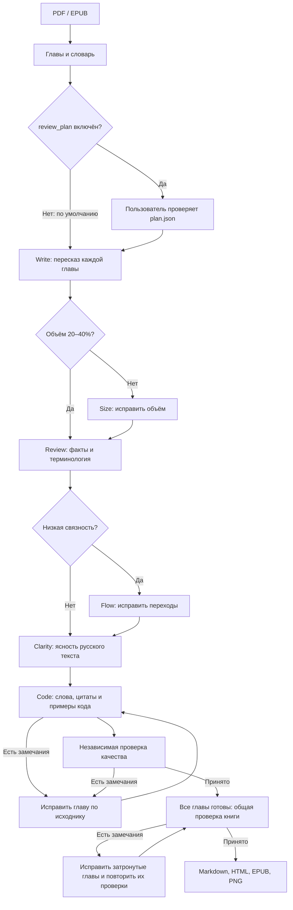

# Пересказ книги из PDF или EPUB

Один пайплайн `book_summary` создаёт русский пересказ книги по схеме из исходного изображения.
Пересказ сохраняет основные мысли, аргументы и существенные примеры автора,
а не переводит книгу целиком. Целевой объём каждой главы — 20–40% исходника
по количеству слов. Счётчик одинаково считает слова исходника и пересказа;
для разных языков это приблизительная мера объёма.



## Запуск

В разделе **Workflow → Пайплайны** выберите `book_summary`. Во вкладке **Запуск**
в поле **Файл книги** выберите PDF или EPUB на своём компьютере.
После сообщения «Книга загружена» нажмите **Запустить**. Путь к книге
передаётся автоматически; для каждой загрузки создаётся отдельный каталог
результата `output_dir`. При желании его можно изменить до запуска.

При запуске через API или Python передайте параметры явно:

```yaml
source_path: /absolute/path/to/book.epub
output_dir: plots/book_summaries/my_book
review_plan: false
```

По умолчанию `review_plan: false`: подготовка, пересказ и сборка выполняются
одним запуском без подтверждения пользователя.

Чтобы проверить план перед написанием, задайте `review_plan: true`.
Пайплайн сохранит `plan.json` и завершится без написания и сборки:
в результате будут `review_required: true`, путь к плану и сообщение
о необходимости проверки. Это завершение после подготовки, а не ошибка.

В полученном каталоге можно открыть `plan.json` и проверить название книги,
порядок и границы глав, затем словарь `glossary`. Названия, порядок, относительные
пути `source_path` и переводы терминов можно исправить перед продолжением.
Тексты глав лежат в `source/`. У каждой главы должен быть уникальный `id`
из букв, цифр, подчёркивания или дефиса.

После проверки повторно запустите тот же `book_summary`:

```yaml
source_path: /absolute/path/to/book.epub
output_dir: plots/book_summaries/my_book
review_plan: true
plan_approved: true
```

Подтверждение — логическое значение `true`, а не строка `"true"`.
Оно требуется только при включённом `review_plan`. Готовая подготовка
используется повторно. Отдельного окна редактирования плана в интерфейсе нет.
Загрузка через браузер сохраняет книгу на сервере без изменения её байтов.
API-действие `workflows.upload_book` принимает `filename` и `content_base64`,
возвращает `source_path`, `output_dir` и `filename`. Оно использует те же
права доступа, что и запуск пайплайнов.

Те же инструменты можно вызвать из Python в окружении проекта:

```python
from custom_tools.book_summary.pipeline import book_prepare_tool, book_summary_tool, book_build_tool

book_prepare_tool("my-session", "/absolute/path/to/book.epub", "plots/book_summaries/my_book")
book_summary_tool("my-session", "plots/book_summaries/my_book")
book_build_tool("my-session", "plots/book_summaries/my_book")
```

## Результаты и продолжение

В `final/` появляются:

- `book.md` — текст для последующего редактирования;
- `index.html` — страница для чтения с оглавлением;
- `book.epub` — электронная книга с оглавлением;
- `pages/page-*.png` — изображения страниц;
- `book.pdf` — промежуточный документ для получения PNG, также пригодный для чтения.

`chapters/<id>/` содержит результаты Write, условных Size/Flow, Review,
Clarity, независимых проверок `verify-*.json`, исправлений `repair-*.json`
и отчёт `checks.json` с количеством слов и оставшимися замечаниями. До трёх глав обрабатываются
одновременно; каждая проходит свой путь независимо от соседних.
Book выполняется после успешного завершения всех глав. При ошибке итоговая
сборка не запускается.

Повторный запуск использует готовые результаты при неизменных исходнике,
словаре и правилах. Неудачный вызов повторяется, успешные предыдущие этапы
сохраняются. При изменении исходных данных или правил пересчитываются
зависящие от них этапы. Если включена ручная проверка, после изменения плана
проверьте его снова перед `plan_approved: true`. Новую исходную книгу готовьте в другом
каталоге, чтобы сохранить материалы прежней.

Если итоговая проверка главы обнаружила неправильный объём, неточную цитату,
изменённый пример кода или ошибку качества, редактор получает конкретные
замечания, текущий текст, исходную главу и словарь. После исправления снова
проверяются объём, цитаты, код и качество; вердикт старой версии не переносится
на исправленный текст. Первое неудачное исправление объёма тоже не завершает
процесс: оставшиеся ошибки устраняются в этом цикле.

Замечания общей проверки содержат идентификаторы глав. Исправляются только
эти главы, после чего они проходят свои проверки, а книга проверяется заново.
Результаты общей проверки сохраняются в `book-review-*.json`, её исправления —
в `chapters/<id>/book-repair-*/`.

На проверку главы и на общую проверку допускается до трёх раундов исправления.
Если ошибки остались, сборка останавливается и показывает конкретные замечания;
результат не принимается автоматически. Попытки сохраняются: после временного
сбоя редактора продолжение не переписывает уже готовый корректный текст.

## Настройки и ограничения

Правила этапов: `config/book_summary/prompts.yaml`. Написание, ясность и
общая проверка используют существующий `model_ultimate`, словарь, независимая
проверка качества и остальные редакторские этапы — `model_code`. Это настройки моделей в `agent_command.py`,
а не жёсткое назначение Opus/Sonnet с картинки. Состояние готовности определяется
по сохранённым файлам обычным кодом без отдельного вызова модели Status.

Для PDF нужна команда `pdftotext`, для PNG — `pdftoppm` из Poppler
(`poppler-utils` в Debian/Ubuntu). Также используются существующие зависимости
проекта BeautifulSoup, Markdown2 и WeasyPrint. EPUB читается в порядке чтения,
заданном внутри книги. PDF делится по заголовкам вида «Глава 1» / «Chapter 1»;
без таких заголовков весь текст становится одной главой. Для ручной проверки
границ включите `review_plan`. Распознавание сканированных страниц не выполняется.
Текст каждой главы должен помещаться в контекст выбранной модели.

Проверки Python считают слова, сопоставляют цитаты в «ёлочках» и включённые
блоки программного кода с исходником. Семантическая точность, перевод терминов,
связность и ясность проверяются моделями; числовые проверки сами по себе
не доказывают качество пересказа. Код из книги никогда не выполняется.
